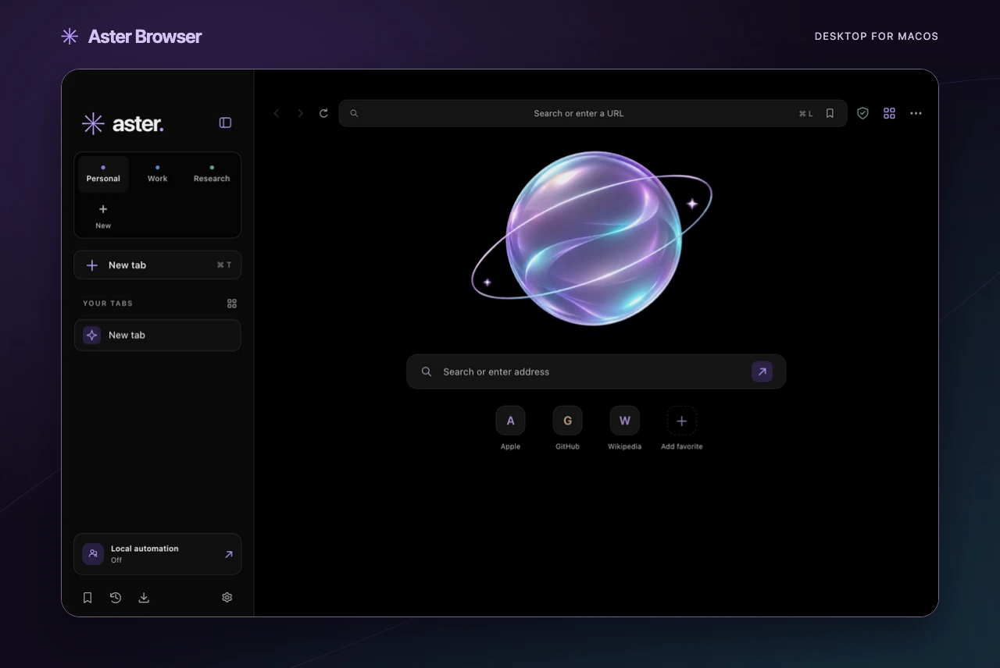
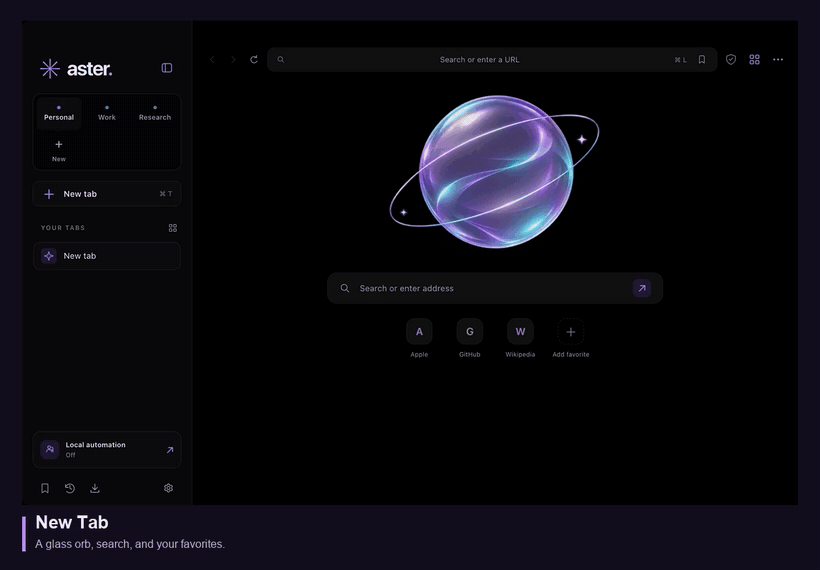
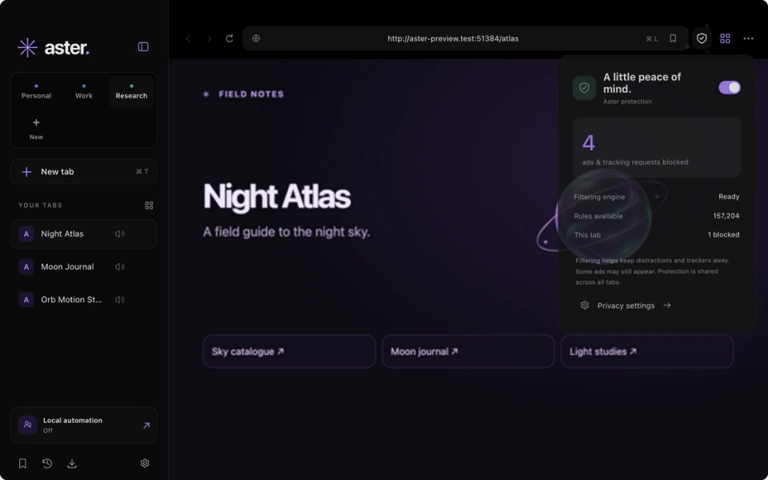
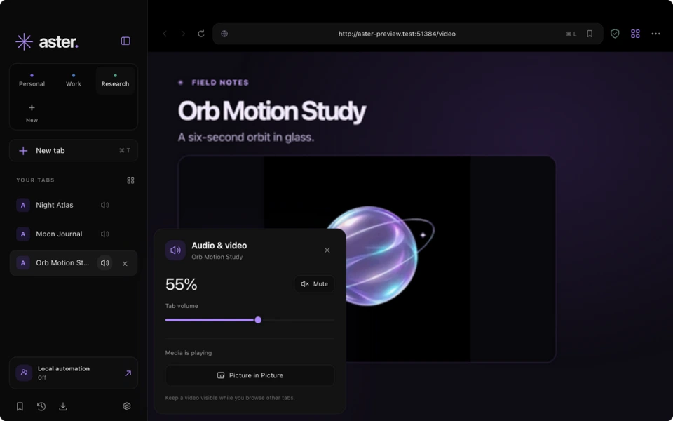

<p align="center">
  
</p>

<h1 align="center">Aster Browser</h1>
<p align="center">A Chromium browser with workspaces, a visual tab overview, and per-tab media controls for macOS and Windows.</p>
<p align="center">
  <a href="#download">Download Aster</a> ·
  <a href="#feature-tour">Feature tour</a> ·
  <a href="mobile/README.md">iOS and Android preview</a> ·
  <a href="CONTRIBUTING.md">Contribute</a>
</p>
<p align="center"><code>Desktop 0.5.0 preview</code> &nbsp; <code>MIT</code></p>

## Download

| Platform | Installer |
| --- | --- |
| macOS 13 or newer, Apple silicon | [Download DMG](https://github.com/manav6786/aster-browser/releases/download/v0.5.0/Aster-0.5.0-mac-arm64.dmg) |
| macOS 13 or newer, Intel | [Download DMG](https://github.com/manav6786/aster-browser/releases/download/v0.5.0/Aster-0.5.0-mac-x64.dmg) |
| Windows, x64 | [Download installer](https://github.com/manav6786/aster-browser/releases/download/v0.5.0/Aster-0.5.0-windows-x64.exe) |

The macOS preview uses an ad hoc signature and awaits Apple notarization. The Windows installer awaits publisher signing. [Release notes and checksums](https://github.com/manav6786/aster-browser/releases/tag/v0.5.0).

## Feature tour

<p align="center">
  
</p>

The tour loops inline when animated images are enabled in your GitHub accessibility settings. [Full-resolution MP4](docs/media/aster-tour.mp4?raw=true).

| Feature | What you can do |
| --- | --- |
| Workspaces and Mission Control | Group tabs, search previews, move cards between spaces, and restore your session. |
| Video and sound | Open a video in native Picture in Picture and change each tab’s volume independently. |
| Protection | Block requests and hide ad elements with Ghostery and open filter lists. Open the shield to see what was blocked. |
| Private tabs | Start a temporary browser session from the browser menu. |
| macOS controls | Swipe Back or Forward, switch between glass and true black, and use the system Reduce Motion setting. |

<p align="center">
  
  
</p>

## Run from source

Install Node.js 24 LTS. On macOS, install the Command Line Tools to build the optional AppKit modules.

```sh
git clone https://github.com/manav6786/aster-browser.git
cd aster-browser
npm ci --ignore-scripts
npm run setup
npm run build:filters
npm start
```

On macOS, use `npm run build:glass` and `npm run build:gesture-phases` before launch for the optional native modules. Check the [build and testing guide](CONTRIBUTING.md) for SDK and packaging requirements.

| Action | macOS | Windows |
| --- | --- | --- |
| Search or enter an address | `⌘L` | `Ctrl+L` |
| Find a tab or command | `⌘K` | `Ctrl+K` |
| Mission Control | `⌘⇧M` | `Ctrl+Shift+M` |
| New private tab | `⌘⇧N` | `Ctrl+Shift+N` |
| Reopen the last closed tab | `⌘⇧T` | `Ctrl+Shift+T` |

## Mobile preview

The companion browser lives in `mobile/`. It uses WebKit on iOS and Android WebView on Android, with an animated start page, search and address entry, tab overview, and local session restore. Both platform bundles can be built from the same source. [Build and test the mobile preview](mobile/README.md).

## Development

The first public commits are organized by feature from the saved desktop builds. Follow the [commit history](https://github.com/manav6786/aster-browser/commits/main/) to see how the browser gained media controls, session restore, trackpad navigation, and the mobile preview. For local scripts and tools, see [local automation](docs/local-automation.md).

Maintained by [Manav Harsora](https://github.com/manav6786). [MIT license](LICENSE) · [Third-party notices](THIRD_PARTY_NOTICES.md).
