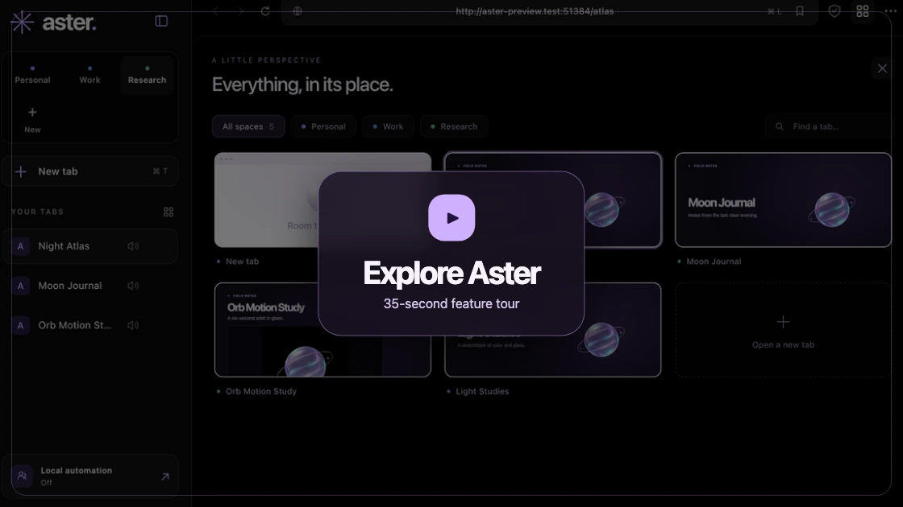
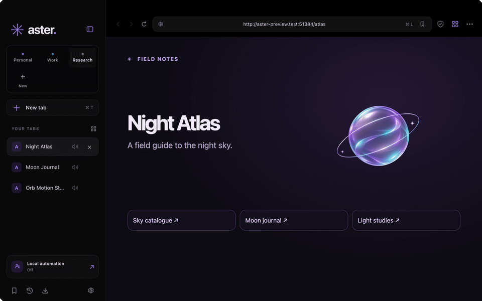

<p align="center">
  
</p>

<h1 align="center">Aster Browser</h1>
<p align="center">A Chromium browser with workspaces, a visual tab overview, and native video controls for macOS.</p>
<p align="center">
  <a href="#run-on-macos">Run on macOS</a> ·
  <a href="#feature-tour">Feature tour</a> ·
  <a href="mobile/README.md">iOS and Android preview</a> ·
  <a href="CONTRIBUTING.md">Contribute</a>
</p>
<p align="center"><code>Desktop 0.4.4</code> &nbsp; <code>Apple silicon</code> &nbsp; <code>MIT</code></p>

## Feature tour

<p align="center">
  <a href="docs/media/aster-tour.mp4"></a>
</p>

The 35-second tour shows New Tab, workspace switching, Mission Control search, live protection counters, tab volume and Picture in Picture, and private tabs. [Play or download the MP4](docs/media/aster-tour.mp4?raw=true).

<p align="center">
  
</p>

| Feature | What you can do |
| --- | --- |
| Workspaces and Mission Control | Group tabs, search previews, move cards between spaces, and restore your session. |
| Video and sound | Open a video in native Picture in Picture and change each tab’s volume independently. |
| Protection | Block requests and hide ad elements with Ghostery and open filter lists. Open the shield to see what was blocked. |
| Private tabs | Press `⌘⇧N` to use a temporary browser session. |
| macOS controls | Swipe Back or Forward, switch between glass and true black, and use the system Reduce Motion setting. |

<p align="center">
  
  
</p>

## Run on macOS

The public preview runs from source on Apple silicon. Install Node.js 24 LTS and the macOS Command Line Tools first.

```sh
git clone https://github.com/manav6786/aster-browser.git
cd aster-browser
npm ci
npm run setup
npm run build:filters
npm start
```

Use `npm run build:glass` and `npm run build:gesture-phases` before launch for the optional native modules. See the [build and testing guide](CONTRIBUTING.md) for required SDKs and packaging.

| Shortcut | Action |
| --- | --- |
| `⌘L` | Search or enter an address |
| `⌘K` | Find a tab or command |
| `⌘⇧M` | Mission Control |
| `⌘⇧N` | New private tab |
| `⌘⇧T` | Reopen the last closed tab |

## Mobile preview

The companion browser lives in `mobile/`. It uses WebKit on iOS and Android WebView on Android, with an animated start page, search and address entry, tab overview, and local session restore. Both platform bundles can be built from the same source. [Build and test the mobile preview](mobile/README.md).

## Development

The first public commits are organized by feature from the saved desktop builds. Follow the [commit history](https://github.com/manav6786/aster-browser/commits/main/) to see how the browser gained media controls, session restore, trackpad navigation, and the mobile preview. For local scripts and tools, see [local automation](docs/local-automation.md).

Maintained by [Manav Harsora](https://github.com/manav6786). [MIT license](LICENSE) · [Third-party notices](THIRD_PARTY_NOTICES.md).
